# Accepting SPIRE JWT-SVIDs in your PingFederate

This guide is for customers and SEs who run their **own PingFederate** (12.x/13.x) and want it to accept a SPIRE-issued **JWT-SVID** — the token format an AI agent gets from a SPIRE server — as a credential.

A SPIRE JWT-SVID is a normal signed JWT with a SPIFFE ID in `sub` (`spiffe://<trust-domain>/ns/<ns>/sa/<name>`), an `aud` array, and `exp`. It is minted by SPIRE, not by PingFederate, so PingFederate must be told to trust SPIRE's issuer and keys. There are three ways to do that, and they answer different questions:

| Mode | Question it answers | Where the config lives | Screenshots below |
|---|---|---|---|
| **A — JWT Bearer Grant Processor** | *Can PingFederate exchange a SPIRE JWT-SVID for its own access token?* | IdP Connection type "JWT Bearer Grant Processor" + an instance under **Authentication > OAuth > JWT Bearer Grant Processors** | A20–A22b |
| **B — Token Exchange (RFC 8693)** | *Can PingFederate swap an incoming SPIFFE token inside an OAuth token exchange?* | **Authentication > Token Exchange > Token Processors** + Processor Policies + an SP connection of type OAuth Token Exchange | A30, A31, B01–B08, C02–C08 |
| **C — No PingFederate at all** | *Do I even need PF? The gateway can verify the SVID itself.* | Privilege Federated Identity (NHI) with **Fetch from URL** key source | n/a — see the lab README |

> **Start with Mode C.** If your goal is only "my PingOne Privilege gateway should accept a SPIFFE JWT-SVID," you do **not** need PingFederate: register a Federated Identity whose key source is *Fetch from URL* pointing at SPIRE's JWKS. That is the verified path (2026-11-19: valid SVID → 200 with tool list; wrong ID / wrong audience / tampered signature / no token → 401). Use Mode A or B when PingFederate must itself mint a token the agent will carry onward.

All screenshots were taken on **PingFederate 13.1.3**. The worked example validates tokens from a real SPIRE 1.7.2 server with:

- **Issuer:** `https://spire.ai-demo.ping-devops.com` (SPIRE's `jwt_issuer`)
- **Keys:** SPIRE's published JWKS (the `oidc-provider` sidecar serves it; PingFederate fetches or you paste it)
- **Audience:** your PingFederate token endpoint (e.g. `https://<your-pf>:9031`) — SPIRE puts the requested audience in the `aud` claim, so request the SVID with `audience` = what your PF expects

---

## Mode A — JWT Bearer Grant Processor (and why it probably won't work)

The JWT Bearer Grant Processor is PingFederate's native mechanism for "partner sends me a JWT, I turn it into my own token." Configure it at **Authentication > OAuth > JWT Bearer Grant Processors**:

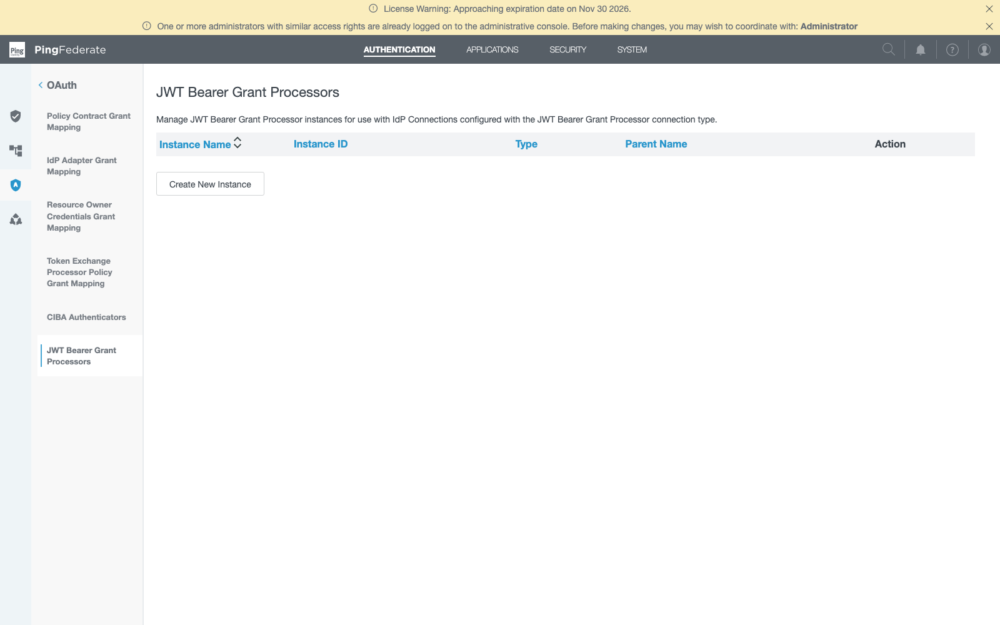

Click **Create New Instance** and look at the TYPE dropdown:

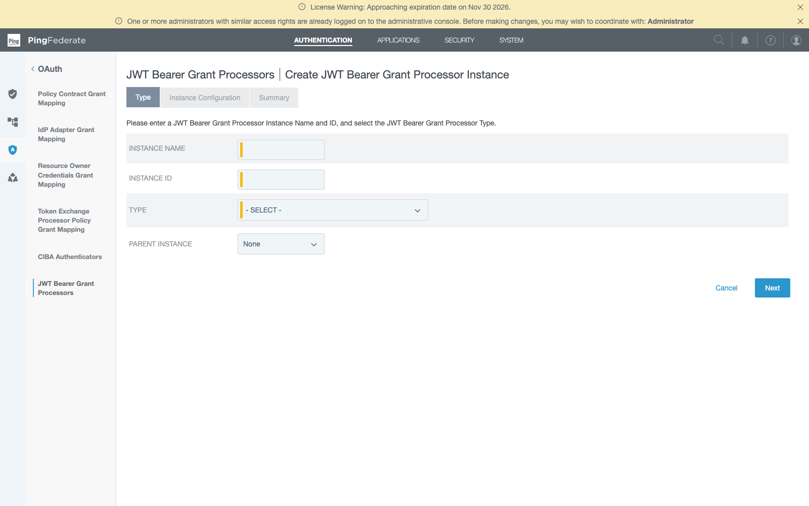

**Finding (13.1.3):** the only shipped processor type is *Mac Platform SSO*. A stock PingFederate install cannot consume a generic SPIRE JWT-SVID through this screen — you would need a custom/plugin processor type. The connection side does exist: an **IdP Connection** with the **JWT Bearer Grant Processor** connection type ticked,

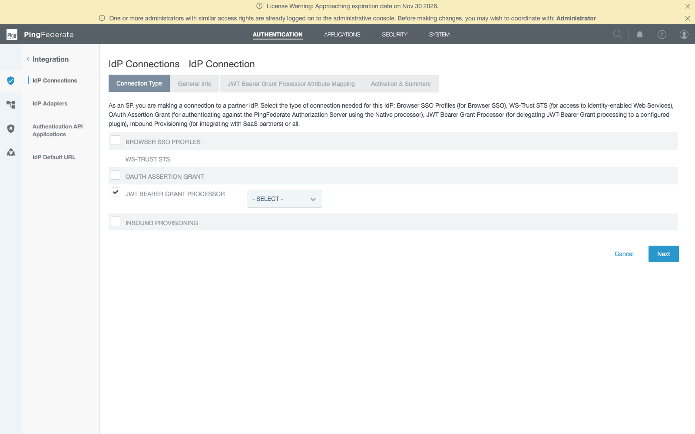

but the instance dropdown is empty until a suitable processor type is installed.

**Practical takeaway:** unless you have a plugin JWT bearer processor, skip Mode A and use Mode B — it achieves the same "SPIRE token in, PingFederate token out" result with built-in components.

---

## Mode B — OAuth Token Exchange with a JWT Token Processor 2.0 (the built-in path)

This is what our demo runs. Three pieces:

1. a **Token Processor instance** that validates the SPIRE JWT-SVID,
2. a **Token Exchange Processor Policy** that maps subject/actor tokens to attributes,
3. an **SP Connection** of type *OAuth Token Exchange* that carries the ID-JAG (identity assertion) semantics.

### Step 1 — Token Processor instance

Go to **Authentication > Token Exchange > Token Processors** (use the console search — type "Token Processors" — if you can't find it in the menus; the search result route is shown here):

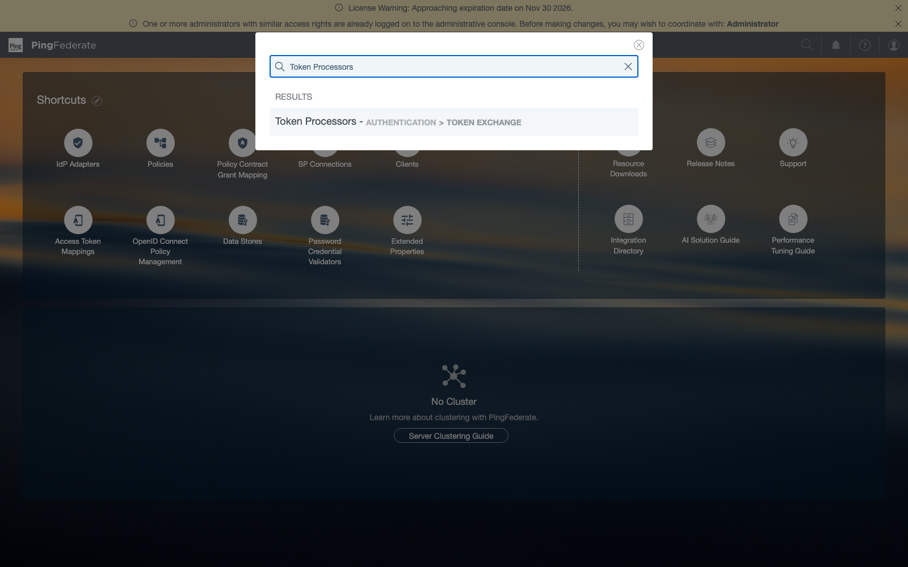

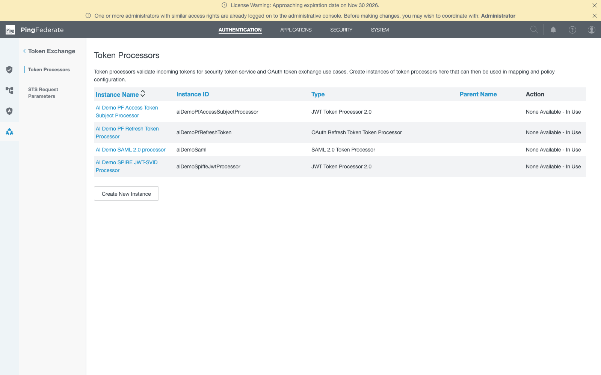

Click **Create New Instance**, choose type **JWT Token Processor 2.0**, and configure:

| Field | Value for SPIRE | Why |
|---|---|---|
| Allowed Issuers | `https://spire.ai-demo.ping-devops.com` (your SPIRE `jwt_issuer`) | must match the SVID `iss` claim exactly |
| Keys | paste SPIRE's JWKS, or point at its JWKS URL | signature verification |
| Allowed Audiences | your PF token endpoint / the audience you request SVIDs for | SPIRE copies the requested audience into `aud` |
| Require Audience / Require Expiration Time | `true` / `true` | sane defaults; SPIRE always sets both |
| Extended Contract | `sub`, plus any claim you need downstream (e.g. `spiffeId`) | claims become attributes for the mapping |

Here is our working instance as configured in the demo:

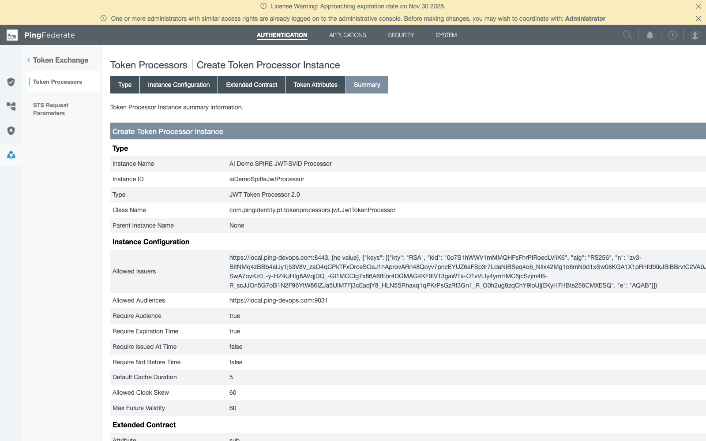

> SPIRE signs with **ES256** (or RS256 on newer builds) and puts `aud` in an **array**. JWT Token Processor 2.0 handles both; if validation fails, decode the SVID and check `iss`/`aud` strings character-for-character first — trailing slashes and scheme mismatches are the usual culprit.

### Step 2 — Token Exchange Processor Policy

Go to **Applications > Token Exchange > Processor Policies**:

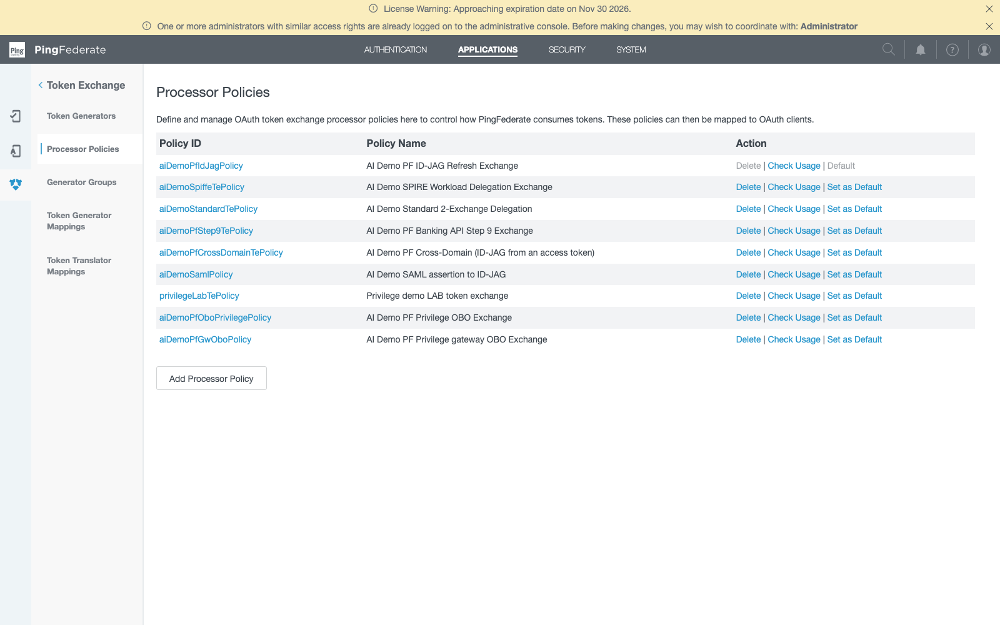

Create a policy, tick **ID-JAG** (Identity Assertion JWT) under allowed requested token types if you will mint identity-assertion tokens, and add the attributes you want in the new token's contract. Our demo policy:

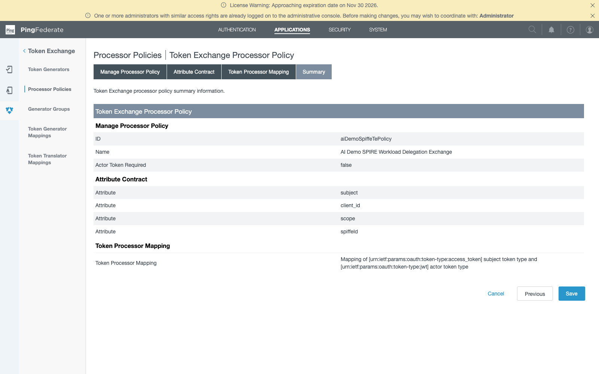

Then on the **Token Processor Mapping** tab, map the token types: the incoming SPIFFE JWT-SVID arrives as one token type (or as the actor token in a delegation exchange) and must be routed to the processor instance from Step 1:

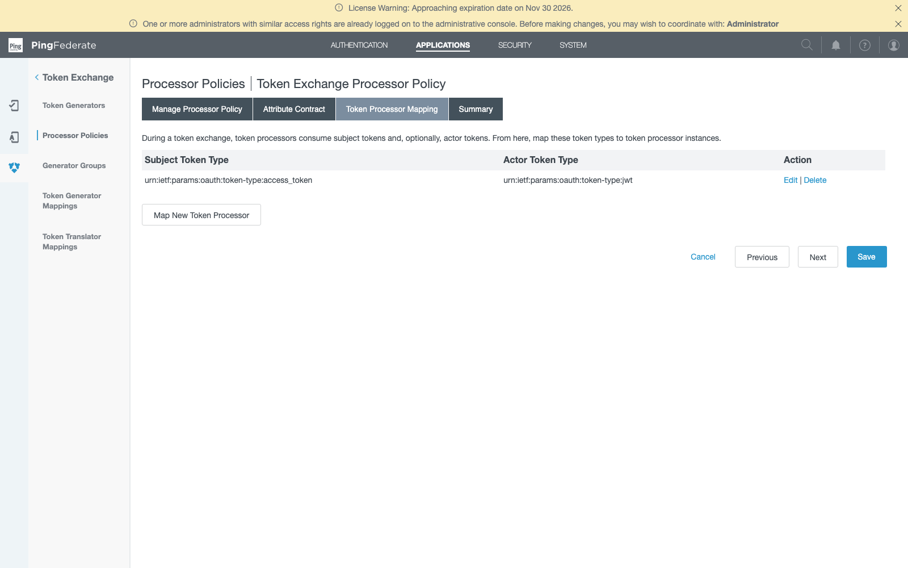

The mapping detail shows which processor instance handles which token type and how contract attributes are fulfilled:

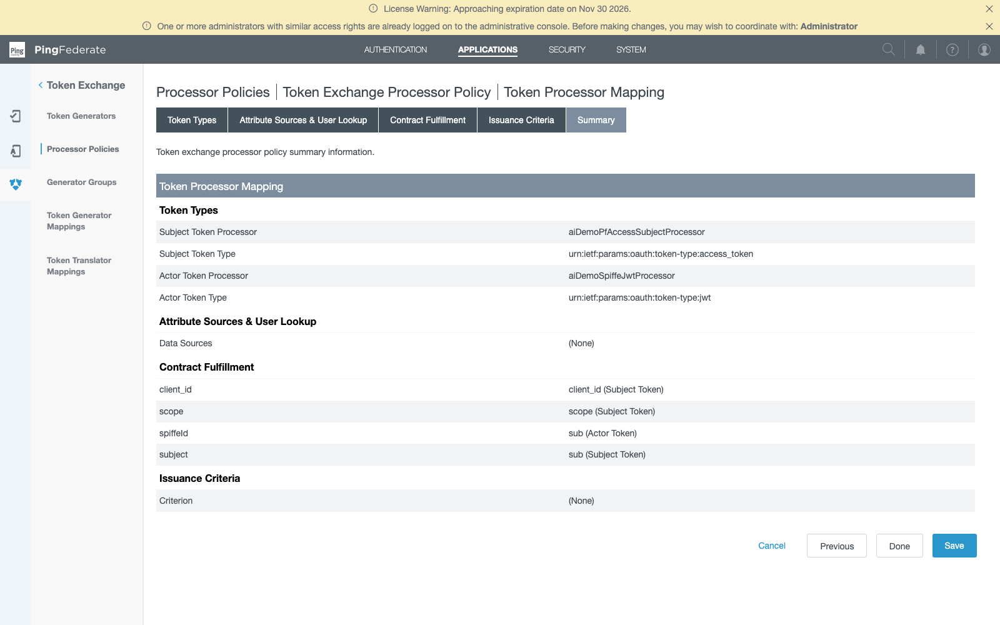

In this demo exchange the **subject** is a PingFederate access token (processed by `aiDemoPfAccessSubjectProcessor`) and the **actor** is the SPIRE JWT-SVID (processed by `aiDemoSpiffeJwtProcessor`); the `spiffeId` attribute in the new token is fulfilled from the actor token's `sub` — i.e. the SPIFFE ID itself travels into the issued token. That is the delegation pattern of [RFC 8693](https://www.rfc-editor.org/rfc/rfc8693): "who is acting on behalf of whom," with the workload identity preserved.

### Step 3 — SP Connection of type OAuth Token Exchange

Go to **Applications > SP Connections > Create Connection**, choose *do not use a template*, and tick **OAuth Token Exchange**:

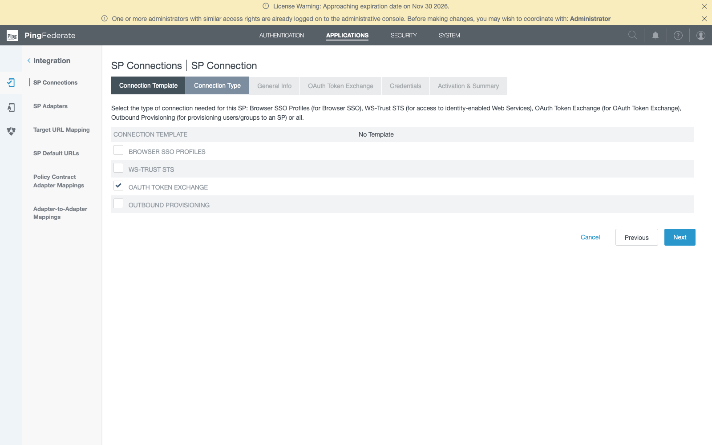

General Info: set Connection ID and Name (the partner's Entity ID is your resource server's base URL):

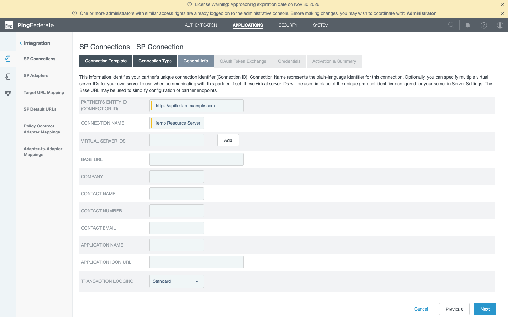

On **Configure OAuth Token Exchange**, tick **Identity Assertion JWT (ID-JAG)** as the allowed requested token type and add the Resource URI(s) the token may be presented to (a Resource URI is required before you can proceed):

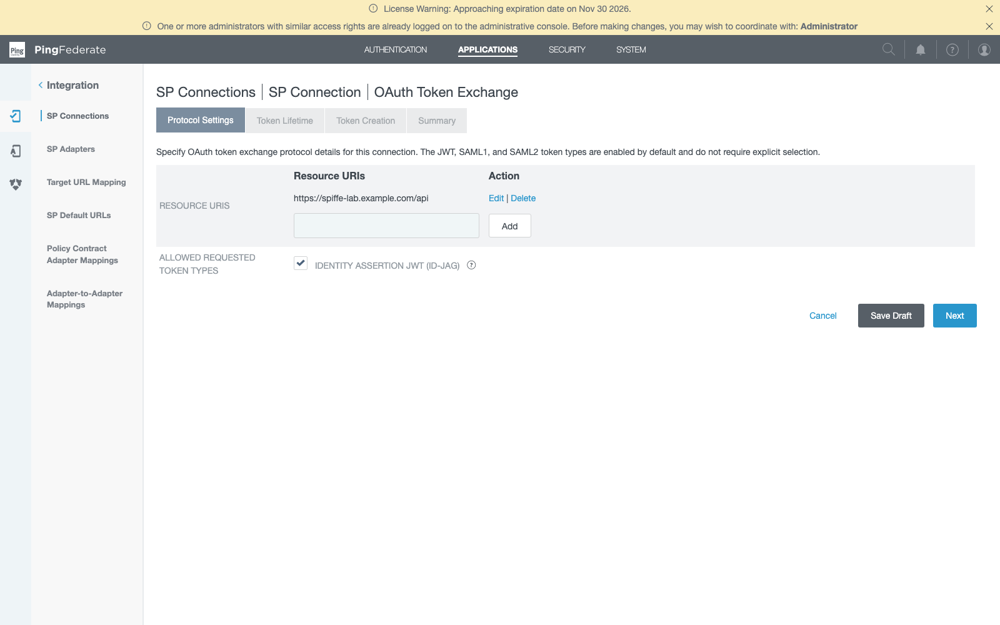

Continue through **Token Lifetime** and **Token Creation**. On the Token Creation tab the attribute contract carries the mapped attributes (here `TOKEN_SUBJECT`):

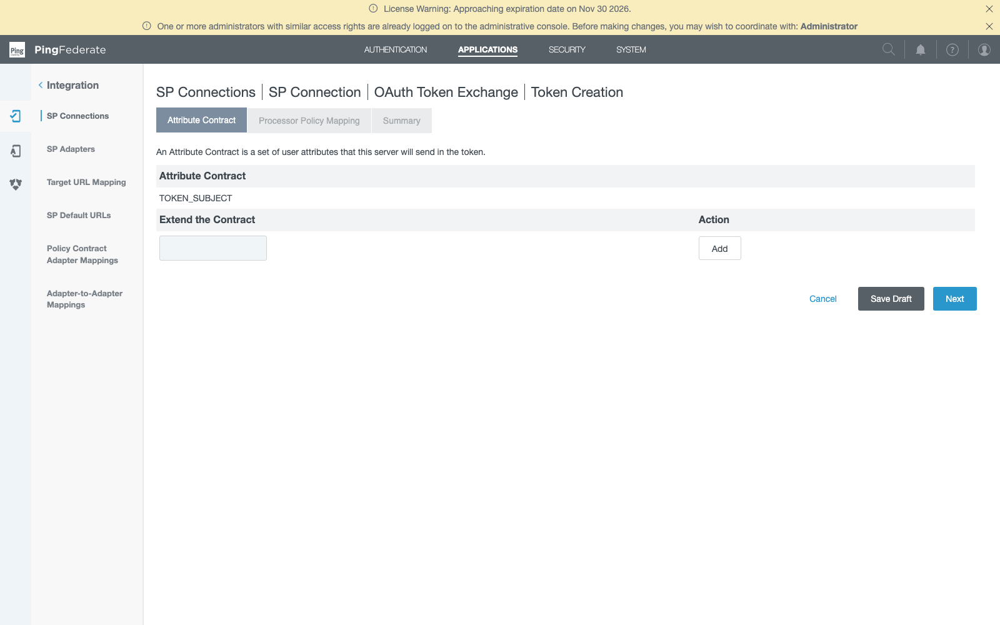

Finally the **Processor Policy Mapping** binds this connection to the policy from Step 2:

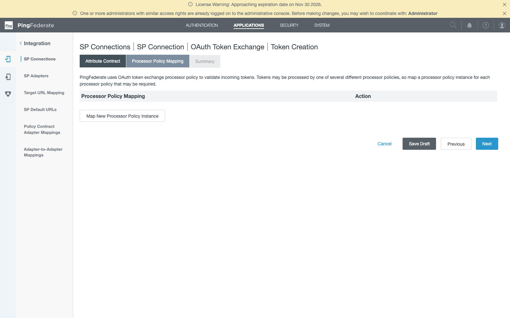

Save and activate. The agent now does:

```
POST https://<your-pf>:9031/as/token.oauth2
grant_type=urn:ietf:params:oauth:grant-type:token-exchange
subject_token=<PingFederate or upstream access token>
actor_token=<SPIRE JWT-SVID>            ← the SPIFFE identity travels here
requested_token_type=...id-jag+jwt
```

and receives a PingFederate-issued JWT that carries the SPIFFE ID as a first-class attribute.

---

## Mode C — no PingFederate: let the gateway verify the SVID directly

If the token's only consumer is a PingOne Privilege gateway door, register a **Federated Identity** (Directory > Federated Identities) with:

- **issuer** = your SPIRE `jwt_issuer`
- **subject** = the exact SPIFFE ID (or better, pin it with RequiredClaims `sub=<spiffe-id>` — the console rejects exact Subject with an empty UserClaim)
- **key source** = *Fetch from URL* pointing at SPIRE's JWKS (key rotation then needs no re-pin: SPIRE publishes current + next key)

This is the configuration the shared SE-cluster SPIRE demo uses and the only mode verified end-to-end against a live gateway (see the [lab README](../../README.md) for the verification record).

---

## Troubleshooting

| Symptom | Usual cause |
|---|---|
| `iss` mismatch rejection | SPIRE's discovery `issuer` string is cosmetic — match the **JWT `iss` claim**, not the discovery doc |
| Audience rejected | you requested the SVID with a different `audience` than PF's Allowed Audiences; re-mint with the right one |
| Signature rejected after SPIRE restart | signing key rotated with the 24 h CA; refetch the JWKS (Fetch-from-URL self-heals, pasted JWKS does not) |
| Can't find Token Processors in the menus | it's under **Authentication > Token Exchange > Token Processors**, or use the console search |
| Mode A type dropdown has nothing usable | stock 13.1 only ships Mac Platform SSO — use Mode B |
| Gateway 401 despite valid token | audience must equal the **door URL**; also check the SPIFFE ID matches the Federated Identity's pinned subject |

## Screenshots

All console screenshots for this guide live in [`img/`](img/) (captured on PingFederate 13.1.3, 2026-11-21). A combined PDF is at [`pingfederate-spire-setup-guide.pdf`](pingfederate-spire-setup-guide.pdf).
